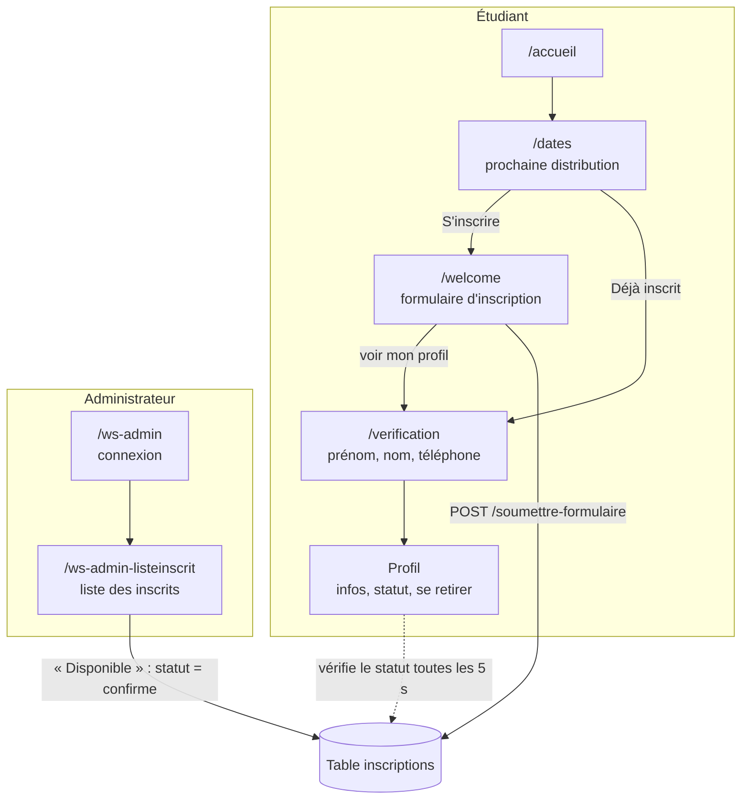

# Waitsmartly

> Une solution de liste d'attente pour la Solidarithèque.

Waitsmartly est une application web qui gère la liste d'attente des étudiants pour les distributions de paniers alimentaires de la Solidarithèque. Quand une place se libère, l'administrateur la propose à un étudiant inscrit. Celui-ci reçoit une notification sur son profil et indique s'il est disponible.

Projet réalisé dans le cadre de mon travail de fin d'études (bachelier).

- **Présentation du projet :** [jodrickmounga.be/projets/tfe](https://jodrickmounga.be/projets/tfe/)
- **Case studies :** [8 articles sur Medium](#case-studies)

---

## Contexte

La Solidarithèque distribue des paniers alimentaires aux étudiants. L'analyse de son fonctionnement a fait ressortir un problème : des rendez-vous manqués entraînent une distribution déséquilibrée, et des paniers restent non distribués alors que d'autres étudiants en auraient besoin.

Waitsmartly vise à :

- améliorer l'efficacité des distributions et alléger le travail de l'association ;
- donner aux étudiants un accès plus équitable aux paniers ;
- réduire le nombre de paniers non distribués.

## Fonctionnalités

### Côté étudiant

- Voir la date de la prochaine distribution (le mercredi suivant, calculé automatiquement).
- S'inscrire sur la liste d'attente (nom, prénom, e-mail, téléphone).
- Retrouver son profil en s'identifiant avec son prénom, son nom et son numéro de téléphone.
- Consulter ses informations et son statut dans la file (`en_attente`, `confirme`).
- Recevoir une notification du navigateur quand une place est proposée, puis confirmer ou refuser sa disponibilité.
- Se retirer de la liste d'attente.

### Côté administrateur

- Se connecter à un espace réservé.
- Voir la liste de tous les inscrits et le nombre de personnes en attente.
- Proposer une place à un inscrit (bouton « Disponible », qui passe son statut à `confirme`).
- Supprimer un inscrit.

## Parcours



**Notifications.** La page profil interroge `/get-inscriptions-status` toutes les 5 secondes. Quand une inscription passe au statut `confirme`, [Push.js](https://pushjs.org/) affiche une notification système. Un clic sur la notification ouvre une fenêtre où l'étudiant confirme ou refuse sa disponibilité.

## Stack technique

| Domaine | Outils |
| --- | --- |
| Back-end | PHP 8.1+, [Laravel 10](https://laravel.com/docs/10.x), [Carbon](https://carbon.nesbot.com/) (dates) |
| Base de données | MySQL / MariaDB (développé avec XAMPP et phpMyAdmin) |
| Front-end | Blade, [Vue 3](https://vuejs.org/) (formulaire d'inscription), Axios |
| Styles | SCSS, [modern-normalize](https://github.com/sindresorhus/modern-normalize) |
| Build | [Vite 5](https://vitejs.dev/) avec `laravel-vite-plugin` |
| Notifications | [Push.js](https://pushjs.org/) (API Notifications du navigateur) |
| Design | Figma, Illustrator, Photoshop, Google Fonts (Montserrat, Indie Flower) |

## Installation en local

### Prérequis

- PHP 8.1 ou plus récent, avec l'extension `pdo_mysql`
- [Composer](https://getcomposer.org/)
- [Node.js](https://nodejs.org/) 18 ou plus récent
- Un serveur MySQL ou MariaDB (par exemple [XAMPP](https://www.apachefriends.org/))

### Étapes

1. Cloner le dépôt et installer les dépendances :

   ```bash
   git clone <url-du-depot> waitsmartly
   cd waitsmartly
   composer install
   npm install
   ```

2. Créer le fichier d'environnement et la clé de l'application :

   ```bash
   cp .env.example .env
   php artisan key:generate
   ```

3. Créer une base de données vide nommée `waitsmartly` (par exemple dans phpMyAdmin). Si la configuration MySQL est différente (utilisateur, mot de passe), adapter la connexion dans `.env` :

   ```env
   DB_DATABASE=waitsmartly
   DB_USERNAME=root
   DB_PASSWORD=
   ```

4. Créer les tables :

   ```bash
   php artisan migrate
   ```

5. Lancer l'application dans deux terminaux :

   ```bash
   npm run dev          # terminal 1 : Vite (CSS et JavaScript)
   php artisan serve    # terminal 2 : serveur Laravel
   ```

6. Ouvrir [http://127.0.0.1:8000/accueil](http://127.0.0.1:8000/accueil).

Pour une version de production, `npm run build` génère les fichiers dans `public/build` et `npm run dev` n'est plus nécessaire.

### Compte administrateur de démonstration

L'espace administrateur est accessible sur [http://127.0.0.1:8000/ws-admin](http://127.0.0.1:8000/ws-admin) avec ce compte :

| Email | Mot de passe |
| --- | --- |
| `admin@heaj.be` | `admin` |

Ces identifiants viennent de `.env.example` et sont copiés dans `.env` à l'étape 2. Ils sont publics : pour une vraie mise en ligne, les remplacer dans le `.env` du serveur (`ADMIN_EMAIL`, `ADMIN_PASSWORD`).

### Dépannage sous Windows (XAMPP)

- **`php` n'est pas reconnu comme commande** : ajouter `C:\xampp\php` à la variable d'environnement `Path`, puis redémarrer le terminal ou l'éditeur.
- **Erreur `SSL certificate verify failed` avec Composer** : le fichier de certificats de XAMPP est trop ancien, ou un antivirus inspecte les connexions HTTPS. Télécharger [cacert.pem](https://curl.se/ca/cacert.pem) et indiquer son chemin dans `php.ini` (`curl.cainfo` et `openssl.cafile`).

## Structure du projet

```text
app/
├── Http/Controllers/
│   ├── AccueilController.php                  page d'accueil
│   ├── DatesController.php                    calcul de la prochaine distribution
│   ├── InscriptionController.php              inscription et statut des inscriptions (JSON)
│   ├── VerificationController.php             identification de l'étudiant → profil
│   ├── ListeInscritController.php             liste admin, suppression, confirmation
│   ├── ConfirmationDisponibiliteController.php
│   └── AuthController.php                     connexion administrateur
└── Models/
    └── Inscription.php
database/migrations/                           tables, dont inscriptions
resources/
├── css/app.scss                               styles de l'application
├── js/
│   ├── app.js                                 initialisation Vue et popups
│   └── component/liste.vue                    formulaire d'inscription
└── views/                                     layout et pages Blade
routes/web.php                                 toutes les routes
```

## Base de données

Table `inscriptions` :

| Colonne | Type | Rôle |
| --- | --- | --- |
| `id` | entier | identifiant de l'inscrit |
| `nom`, `prenom` | texte | identité |
| `email`, `telephone` | texte | contact |
| `statut` | texte, `en_attente` par défaut | position dans le processus (`en_attente`, `confirme`, `disponible`) |
| `rdv` | texte, `en_attente` par défaut | prévu pour la gestion des rendez-vous |
| `created_at`, `updated_at` | date | horodatage |

## Routes principales

| Méthode | URL | Rôle |
| --- | --- | --- |
| GET | `/accueil` | page d'accueil |
| GET | `/dates` | prochaine distribution |
| GET | `/` ou `/welcome` | formulaire d'inscription |
| POST | `/soumettre-formulaire` | enregistrement d'une inscription |
| GET / POST | `/verification` | identification de l'étudiant, puis profil |
| DELETE | `/ws-client-listeinscrit/{id}` | l'étudiant se retire de la liste |
| GET | `/get-inscriptions-status` | statut des inscriptions (JSON) |
| GET / POST | `/ws-admin` | connexion administrateur |
| GET | `/ws-admin-listeinscrit` | liste des inscrits |
| POST | `/ws-admin-listeinscrit/confirmer` | proposer une place (statut `confirme`) |
| DELETE | `/ws-admin-listeinscrit/{id}` | suppression par l'administrateur |
| GET | `/confirmer` | page de confirmation de récupération |

## Limites connues et pistes d'amélioration

Waitsmartly est un prototype réalisé dans le cadre d'un TFE. Voici les points à traiter avant une mise en production :

- **Authentification administrateur.** Un seul compte, défini dans `.env` (`ADMIN_EMAIL`, `ADMIN_PASSWORD`), et aucune session n'est créée après la connexion. Les pages d'administration ne sont donc pas protégées. Piste : utiliser l'authentification de Laravel (Breeze) et le middleware `auth`.
- **Protection CSRF.** Elle est désactivée pour toutes les routes (`VerifyCsrfToken`). Le jeton est pourtant déjà présent dans les formulaires et le layout : il suffirait de la réactiver.
- **Données personnelles.** `/get-inscriptions-status` renvoie toutes les inscriptions, et les notifications ne sont pas filtrées sur l'étudiant connecté.
- **Identification de l'étudiant.** Elle se fait par prénom, nom et téléphone, sans mot de passe ni lien envoyé par e-mail.
- **Réponse de disponibilité.** Elle est affichée (fond vert ou rouge) mais pas encore enregistrée en base. La route `POST /confirmation-disponibilite/{id}` est prête mais n'est pas encore appelée.
- **Fonctionnalités prévues.** Consulter son rang dans la file, ajouter la date de distribution à son agenda, gérer les rendez-vous (colonne `rdv`).
- **Tests.** Il n'y a pas encore de tests automatisés.

## Case studies

Le processus de conception est documenté en 8 articles sur Medium :

1. [TFE – Case study n°1](https://medium.com/@tchamojodrick/tfe-case-study-n-1-a12f440dbca5)
2. [TFE – Case study n°2](https://medium.com/@tchamojodrick/tfe-case-study-n-2-1051184d1344)
3. [TFE – Case study n°3](https://medium.com/@tchamojodrick/tfe-case-study-n-3-ef78123bd6f3)
4. [TFE – Case study n°4](https://medium.com/@tchamojodrick/tfe-case-study-n-4-745671a2de0d)
5. [TFE – Case study n°5](https://medium.com/@tchamojodrick/tfe-case-study-n-5-9602a6bcd33d)
6. [TFE – Case study n°6](https://medium.com/@tchamojodrick/tfe-case-study-n-6-63dde787859a)
7. [TFE – Case study n°7](https://medium.com/@tchamojodrick/tfe-case-study-n-7-848e731cbb9b)
8. [TFE – Case study n°8](https://medium.com/@tchamojodrick/tfe-case-study-n-8-2657689b5297)

## Crédits

- [Laravel](https://laravel.com/docs/10.x/releases), [Vue.js](https://vuejs.org/), [Push.js](https://pushjs.org/), [Carbon](https://carbon.nesbot.com/), [phpMyAdmin](https://www.phpmyadmin.net/docs/)
- Documentation [MDN](https://developer.mozilla.org/fr/)
- Illustrations : Figma, Illustrator, Photoshop
- Typographies : [Google Fonts](https://fonts.google.com/)

## Auteur

**Jodrick Mounga Tchamo**, [jodrickmounga.be](https://jodrickmounga.be/)
